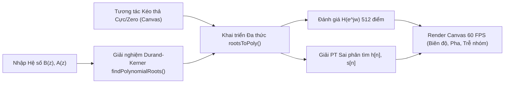

# BÁO CÁO THIẾT KẾ CÔNG CỤ
## Đề tài 13: Xây dựng Web App Tương tác Phân tích Biểu đồ Pole-Zero và Đáp ứng Tần số Hệ LTI

---

### 1. Tổng quan & Mục tiêu Thiết kế
Công cụ **LTI Pole-Zero Studio** được thiết kế nhằm giải quyết bài toán trực quan hóa trong môn học **Xử lý Tín hiệu Số (DSP)** và **Hệ thống Tuyến tính Bất biến (LTI)**:
- Giúp người học cảm nhận trực tiếp mối liên hệ hình học giữa vị trí **Cực (Poles - $\times$)** và **Không điểm (Zeros - $\circ$)** trên mặt phẳng phức $Z$ với **Miền hội tụ (ROC)**, **Tính ổn định BIBO**, **Đáp ứng xung $h[n]$** và **Đáp ứng tần số $H(e^{j\omega})$**.
- Đạt tốc độ phản hồi **60–120 FPS thực tế** khi kéo thả trực tiếp trên `<canvas>`, không độ trễ, không phụ thuộc vào backend hay cài đặt môi trường phức tạp.

---

### 2. Cơ sở Toán học Xử lý Tín hiệu Số (DSP)

#### 2.1. Hàm truyền Hệ thống LTI Rời rạc
Một hệ thống LTI rời rạc được mô tả bởi phương trình sai phân tuyến tính hệ số hằng:
$$\sum_{k=0}^{N} a_k y[n-k] = \sum_{m=0}^{M} b_m x[n-m]$$

Biến đổi Z hai phía cho ta hàm truyền:
$$H(z) = \frac{Y(z)}{X(z)} = \frac{\sum_{m=0}^{M} b_m z^{-m}}{\sum_{k=0}^{N} a_k z^{-k}} = K \frac{\prod_{i=1}^{M} (1 - z_i z^{-1})}{\prod_{k=1}^{N} (1 - p_k z^{-1})}$$
Trong đó:
- $z_i \in \mathbb{C}$ là các **Zero** (nghiệm của đa thức tử số $B(z) = 0$).
- $p_k \in \mathbb{C}$ là các **Cực / Pole** (nghiệm của đa thức mẫu số $A(z) = 0$).
- $K = b_0 / a_0$ là hệ số khuếch đại (Gain).

#### 2.2. Miền Hội tụ (ROC) và Điều kiện Ổn định BIBO
Gọi $r_{\max} = \max_k |p_k|$ và $r_{\min} = \min_k |p_k|$:
1. **Hệ nhân quả (Causal System):** $h[n] = 0, \forall n < 0$. Miền hội tụ hướng ra ngoài cực lớn nhất:
   $$\text{ROC} = \{z \in \mathbb{C} : |z| > r_{\max}\}$$
   Hệ nhân quả ổn định BIBO khi và chỉ khi đường tròn đơn vị $|z|=1$ nằm trong ROC $\iff r_{\max} < 1$ (mọi cực nằm bên trong đường tròn đơn vị).
2. **Hệ phản nhân quả (Anti-Causal System):** $h[n] = 0, \forall n \ge 0$. Miền hội tụ hướng vào trong cực nhỏ nhất:
   $$\text{ROC} = \{z \in \mathbb{C} : |z| < r_{\min}\}$$
   Ổn định BIBO khi $r_{\min} > 1$.
3. **Hệ hai phía (Two-sided Stable System):** Chọn ROC dạng hình vành khăn $r_{\text{in}} < |z| < r_{\text{out}}$ chứa đường tròn đơn vị $|z|=1$.

#### 2.3. Giải thích Hình học của Đáp ứng Tần số $H(e^{j\omega})$
Khi hệ ổn định BIBO, biến đổi Fourier thời gian rời rạc (DTFT) tồn tại và thu được bằng cách thay $z = e^{j\omega}$ ($\omega \in [-\pi, \pi]$):
$$|H(e^{j\omega})| = |K| \cdot \frac{\prod_{i=1}^{M} |e^{j\omega} - z_i|}{\prod_{k=1}^{N} |e^{j\omega} - p_k|}$$
$$\angle H(e^{j\omega}) = \angle K + \sum_{i=1}^{M} \angle(e^{j\omega} - z_i) - \sum_{k=1}^{N} \angle(e^{j\omega} - p_k) + (N - M)\omega$$

---

### 3. Kiến trúc Phần mềm & Giải thuật Cốt lõi (Pure JS Engine)

Toàn bộ phần tính toán số học phức và giải tích đa thức được viết trực tiếp bằng JavaScript thuần trong [`index.html`](file:///C:/Users/lecon/.gemini/antigravity/scratch/lti-pole-zero-analyzer/index.html):

#### 3.1. Thuật toán Tìm nghiệm Đa thức Durand-Kerner (`findPolynomialRoots`)
Để giải phương trình bậc cao $P(z) = z^n + c_1 z^{n-1} + \dots + c_n = 0$ (bao gồm cả nghiệm thực và nghiệm phức liên hợp) mà không cần thư viện ngoài, công cụ cài đặt phép lặp đồng thời **Durand-Kerner (Weierstrass)**:
$$z_k^{(m+1)} = z_k^{(m)} - \frac{P\left(z_k^{(m)}\right)}{\prod_{j \neq k} \left(z_k^{(m)} - z_j^{(m)}\right)}$$
- **Đánh giá đa thức:** Dùng sơ đồ Horner phức với độ phức tạp $O(n)$.
- **Khởi tạo:** Các điểm xuất phát $z_k^{(0)}$ phân bố trên vòng tròn phức với góc lệch bất đối xứng $+0.3719\text{ rad}$ để tránh hiện tượng đối xứng làm mẫu số triệt tiêu.
- **Tốc độ hội tụ:** Hội tụ bậc hai sau khoảng 15–35 vòng lặp với ngưỡng dừng $\max_k |\Delta z_k| < 10^{-11}$.

#### 3.2. Thuật toán Khai triển Nghiệm thành Hệ số Đa thức (`rootsToPoly`)
Khi người dùng kéo thả các cực/zero trên mặt phẳng phức, hệ thống thực hiện tích chập 1D liên tiếp các nhị thức phức $(1 - r_k z^{-1})$ để cập nhật tức thời các hệ số $b_0, b_1, \dots, b_M$ và $a_0, a_1, \dots, a_N$.

#### 3.3. Giải Phương trình Sai phân Thời gian Thực (`solveDifferenceEquation`)
Đáp ứng xung $h[n]$ (với đầu vào $x[n] = \delta[n]$) và đáp ứng nhảy bậc $s[n]$ (với $x[n] = u[n]$) được tính đệ quy trực tiếp:
$$y[n] = \frac{1}{a_0} \left( \sum_{m=0}^{M} b_m x[n-m] - \sum_{k=1}^{N} a_k y[n-k] \right)$$
Thuật toán có cơ chế chống tràn số (`overflow clamping` ở ngưỡng $\pm 10^6$) để vẫn vẽ được dạng sóng phân kỳ mũ khi người học cố tình kéo cực ra ngoài đường tròn đơn vị.

---

### 4. Tối ưu hóa Hiệu năng Đồ họa 60 FPS
1. **HTML5 Canvas kết hợp `requestAnimationFrame`:** Bắt sự kiện `mousedown`, `mousemove`, `mouseup` trực tiếp trên `<canvas>` và gom các lệnh vẽ theo chu kỳ quét màn hình.
2. **Hỗ trợ Màn hình Độ phân giải Cao (HiDPI / Retina):** Tự động nhân ma trận biến đổi với `window.devicePixelRatio` giúp đường tròn đơn vị, ký hiệu $\times, \circ$ và đồ thị phổ sắc nét.
3. **Bộ nhớ đệm `Float64Array`:** Không cấp phát đối tượng dư thừa trong vòng lặp vẽ, giữ thời gian tính toán mỗi khung hình dưới **2 ms**.
