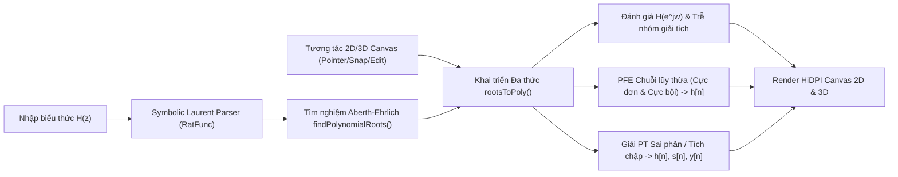

# BÁO CÁO THIẾT KẾ CÔNG CỤ
## Đề tài 13: Xây dựng Web App Tương tác Phân tích Biểu đồ Pole-Zero và Đáp ứng Tần số Hệ LTI

---

### 1. Tổng quan & Mục tiêu Thiết kế
Công cụ **LTI Pole-Zero Studio** được thiết kế nhằm giải quyết bài toán trực quan hóa trong môn học **Xử lý Tín hiệu Số (DSP)** và **Hệ thống Tuyến tính Bất biến (LTI)**:
- Giúp người học cảm nhận trực tiếp mối liên hệ hình học giữa vị trí **Cực (Poles - $\times$)** và **Không điểm (Zeros - $\circ$)** trên mặt phẳng phức $Z$ (ở cả góc nhìn **2D $\text{Im}-\text{Re}$** và **Mặt cong 3D $|H(z)|$**) với **Miền hội tụ (ROC)**, **Tính ổn định BIBO**, **Đáp ứng xung $h[n]$** và **Đáp ứng tần số $H(e^{j\omega})$**.
- Đạt tốc độ phản hồi **60–120 FPS thực tế** khi kéo thả trực tiếp trên HTML5 `<canvas>`, không độ trễ, không phụ thuộc vào backend hay cài đặt môi trường phức tạp.

---

### 2. Cơ sở Toán học Xử lý Tín hiệu Số (DSP)

#### 2.1. Hàm truyền Hệ thống LTI Rời rạc
Một hệ thống LTI rời rạc được mô tả bởi phương trình sai phân tuyến tính hệ số hằng:
$$\sum_{k=0}^{N} a_k y[n-k] = \sum_{m=0}^{M} b_m x[n-m]$$

Biến đổi Z hai phía cho ta hàm truyền:
$$H(z) = \frac{Y(z)}{X(z)} = \frac{\sum_{m=0}^{M} b_m z^{-m}}{\sum_{k=0}^{N} a_k z^{-k}} = K \cdot z^{-d} \frac{\prod_{i} (1 - z_i z^{-1})}{\prod_{k} (1 - p_k z^{-1})}$$
Trong đó:
- $z_i \in \mathbb{C}$ là các **Zero** (nghiệm của đa thức tử số $B(z) = 0$).
- $p_k \in \mathbb{C}$ là các **Cực / Pole** (nghiệm của đa thức mẫu số $A(z) = 0$).
- $K = b_d / a_0$ là hệ số khuếch đại (Gain) và $d$ là bậc trễ thuần túy.

#### 2.2. Miền Hội tụ (ROC) và Điều kiện Ổn định BIBO
Gọi $r_{\max} = \max_k |p_k|$ và $r_{\min} = \min_k |p_k|$ (với $p_k \neq 0$):
1. **Hệ nhân quả (Causal System):** $h[n] = 0, \forall n < 0$. Miền hội tụ hướng ra ngoài cực lớn nhất:
   $$\text{ROC} = \{z \in \mathbb{C} : |z| > r_{\max}\}$$
   Hệ nhân quả ổn định BIBO khi và chỉ khi đường tròn đơn vị $|z|=1$ nằm trong ROC $\iff r_{\max} < 1$.
2. **Hệ phản nhân quả (Anti-Causal System):** $h[n] = 0, \forall n \ge 0$. Miền hội tụ hướng vào trong cực nhỏ nhất:
   $$\text{ROC} = \{z \in \mathbb{C} : |z| < r_{\min}\}$$
   Ổn định BIBO khi $r_{\min} > 1$.
3. **Hệ hai phía (Two-sided Stable System):** Chọn ROC dạng hình vành khăn $r_{\text{in}} < |z| < r_{\text{out}}$ chứa đường tròn đơn vị $|z|=1$.

#### 2.3. Giải thích Hình học & Trễ nhóm Giải tích
Khi hệ ổn định BIBO, biến đổi Fourier thời gian rời rạc (DTFT) thu được tại $z = e^{j\omega}$:
$$|H(e^{j\omega})| = |K| \cdot \frac{\prod_{i} |e^{j\omega} - z_i|}{\prod_{k} |e^{j\omega} - p_k|}$$
Trễ nhóm được tính bằng công thức giải tích chính xác (loại bỏ hoàn toàn nhiễu sai phân số tại các Zero nằm trên $|z|=1$):
$$\tau_g(\omega) = -\frac{d}{d\omega}\angle H(e^{j\omega}) = \operatorname{Re}\left(\frac{B'(e^{-j\omega})}{B(e^{-j\omega})} - \frac{A'(e^{-j\omega})}{A(e^{-j\omega})}\right)$$

---

### 3. Kiến trúc Phần mềm & Giải thuật Cốt lõi (Modular Pure JS)

Mã nguồn được tách thành 3 module JavaScript độc lập kết hợp với [`index.html`](index.html) và [`css/styles.css`](css/styles.css):

#### 3.1. Bộ Phân tích Đại số Laurent Hữu tỷ (`parseTransferFunctionString`)
Cài đặt Recursive-Descent Parser trên lớp `LaurentPoly` và `RatFunc`, cho phép nhập các phân thức lồng nhau (ví dụ `1/2 * (1 - z^-1)/(1 - 0.8*z^-1)`), lũy thừa âm/dương (`(1 - 0.5*z^-1)^-2`) và ký hiệu khoa học (`1e-3`) với độ chính xác đại số tuyệt đối.

#### 3.2. Thuật toán Tìm nghiệm Đa thức Aberth-Ehrlich (`findPolynomialRoots`)
Kết hợp công thức nghiệm chính xác cho bậc 1–2 và phép lặp đồng thời **Aberth-Ehrlich** hội tụ bậc ba cho bậc cao:
$$z_k^{(m+1)} = z_k^{(m)} - \frac{P(z_k^{(m)}) / P'(z_k^{(m)})}{1 - \frac{P(z_k^{(m)})}{P'(z_k^{(m)})} \sum_{j \neq k} \frac{1}{z_k^{(m)} - z_j^{(m)}}}$$
Sau hội tụ, bộ gom cụm nghiệm tự động phát hiện các nghiệm bội (ví dụ cực kép, cực bội ba) để chuẩn hóa chính xác.

#### 3.3. Khai triển Phân thức Tối giản Tổng quát (`buildAnalyticalHnLatex`)
- Thực hiện chia đa thức $B(z^{-1}) / A(z^{-1})$ khi $\deg(B) \ge \deg(A)$ để tách các xung $\delta[n - m]$.
- Áp dụng **số học chuỗi lũy thừa cắt cụt (Truncated Power Series)** với phép thế $z^{-1} = p_k^{-1}(1 - w)$ để tính toàn bộ hệ số $C_{k, s}$ cho cực bội $M$:
  $$\frac{C_{k,s}}{(1 - p_k z^{-1})^s} \xleftrightarrow{\mathcal{Z}^{-1}} C_{k,s} \binom{n+s-1}{s-1} p_k^n u[n]$$

---

### 4. Tối ưu hóa Hiệu năng & Trải nghiệm Người dùng (UI/UX)
1. **HiDPI Canvas 2D & 3D + `requestAnimationFrame`:** Tự động nhân `devicePixelRatio`, hỗ trợ **Pointer Events** cho cả chuột và màn hình cảm ứng, cuộn chuột Zoom, bắt dính `|z| = 1`, và **Undo/Redo (`Ctrl+Z`/`Ctrl+Y`)**.
2. **Đồ thị tương tác & Chỉnh sửa chính xác:** Hover tooltip trên tất cả đồ thị tần số & thời gian; bảng nghiệm cho phép sửa trực tiếp tọa độ $(Re, Im)$ hoặc $(r, \angle^\circ)$.
3. **Dual-Theme & In ấn Báo cáo (`@media print`):** Chuyển đổi giữa **Xanh Tối Gốc** và **Sáng Bách Khoa**, cùng chế độ xuất PDF tự động định dạng báo cáo nền trắng sạch sẽ.
